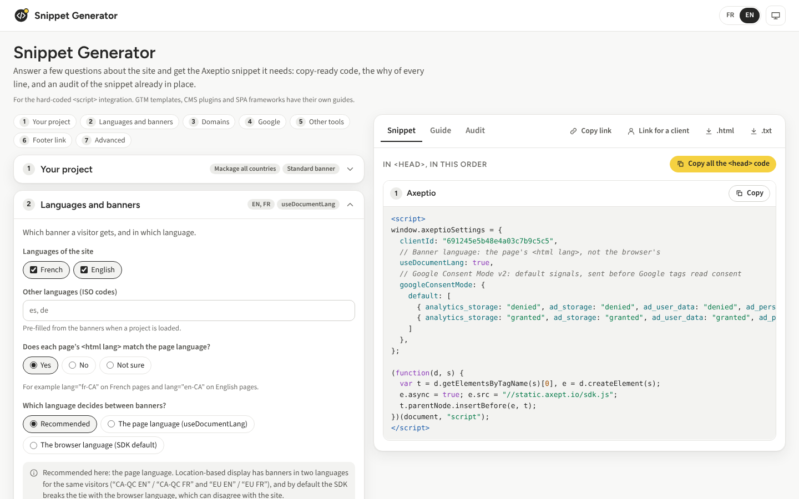

# Snippet Generator

**Answer a few questions about a site and get the Axeptio snippet it needs: copy-ready code, the why of every line, and an audit of the snippet already in place.**

For the hard-coded `<script>` integration. GTM templates, CMS plugins and SPA frameworks have their
own guides. Load a published project and the generator pre-fills the answers from it (banner type,
languages, vendors, the Consent Mode step), then writes only what differs from the SDK's defaults.

**Live:** https://pggpgg.github.io/snippet-generator/ · Français plus bas.



## What it does

- **Wizard in seven steps.** Your project, languages and banners, domains, Google, other tools,
  footer link, advanced. Expert mode lists every `axeptioSettings` key the SDK reads, with its
  default, and writes only the ones you change (or pin).
- **Snippet.** The blocks in `<head>` order (preconnects, Consent Mode defaults, Axeptio, tools that
  wait for consent, cross-domain sharing), then the footer link, each with its own copy button.
- **Guide.** Where each block goes, the why of every line, basic vs advanced Consent Mode, the
  constraints of cross-domain sharing, and the notes that apply to this site.
- **Audit.** Paste the snippet already on the site. Every rule of the spec runs (A1 to A7, G1 to G4,
  X1, P1, P2) and explains the mechanism and the fix. "Load into the wizard" turns the paste into
  wizard answers and shows the corrected snippet as a line diff.
- **Sharing.** "Copy link" keeps the whole state. "Link for a client" adds a "Prepared by" card
  (name, contact, note) and opens a read-only view of the snippet and the guide. Downloads: a
  standalone, printable `.html` guide and a `.txt` of the code. FR/EN, light and dark themes.

## How it decides what to write

- **Minimal code.** A key is written only when its value differs from the SDK default, or when you
  pin it in expert mode.
- **Banner language.** With location-based display and banners in two languages for the same
  visitors, the SDK breaks the tie with the browser language. When the site's `<html lang>` is
  right, the generator writes `useDocumentLang: true` instead of pinning a banner with
  `cookiesVersion`.
- **Google Consent Mode v2.** A denied fallback, plus a granted entry for the opt-out regions of
  the project (for example `US` and Canada except Quebec). With Google Tag Manager the defaults go in
  `axeptioSettings.googleConsentMode`; with gtag.js they go in an inline `gtag('consent', 'default')`
  block placed first. You can override the choice.
- **Other tools.** Paste a vendor's tag and it is rewritten to load in an Axeptio callback
  (`_axcb.push` and `cookies:complete`), keyed on the vendor's name in the project, at most once.
- **Cross-domain consent.** The help center script (spec Appendix A), with your list of domains.
- **CSP.** With a nonce, every generated script carries it and the footer link uses a listener
  instead of an inline `onclick`.

## Using it

- **Project ID**: in the Axeptio admin (bottom left of a project), or `axeptioSettings.clientId` on
  the site. Pasting an admin URL works too. Recent projects are offered as you type.
- **Links** keep the whole state in the URL fragment, so pasted vendor code never reaches a server
  log. The audit text is never included.

  | Parameter | Meaning |
  |---|---|
  | `s` | The state: JSON, compressed (`deflate-raw`), base64url. Carries a version for future migrations |
  | `view=client` | Read-only client view: the snippet and the guide, under the "Prepared by" card |
  | `ui` | Interface language, `fr` or `en` |
  | `internal=1` | Show links to the Axeptio admin (useful for the Axeptio team only) |

- **Stored in the browser** (`localStorage`, safe to clear): `snippet-generator:ui`,
  `snippet-generator:theme`, `snippet-generator:recent`.

## Development

```bash
npm install
npx playwright install chromium   # once
npm run serve          # http://localhost:4173
npm test               # Playwright: the spec's acceptance tests, every audit rule, copy, URL state, UI, drift check
npm run sdk:check      # compare the live sdk.js and tcf/sdk.js with sdk-snapshot.json (needs static.axept.io)
npm run sdk:snapshot   # refresh the snapshot, after updating index.html
```

No build step and no runtime dependency: `index.html` is the app, with its CSS and JS inline.
The JS has two marked parts: the pure logic, exposed as `window.SnippetGenerator` (`generate`,
`audit`, `parse`, `encodeState`, `decodeState` and their helpers), and the UI, which only talks to
that object. Fonts (Figtree, Source Sans 3) are self-hosted; the page makes no request to anything
but its own files and Axeptio's CDN. `package.json` exists only for the tests.

```
index.html          the whole app
fonts/              Figtree and Source Sans 3, latin + latin-ext woff2 (OFL)
tests/              Playwright suites + trimmed real project files (tests/fixtures)
scripts/            the SDK drift check
sdk-snapshot.json   what the drift check compares against
SPEC.md             the build spec
```

## Staying faithful to the SDK

- The facts in `SPEC.md` (sections 2 to 4) were checked against `sdk.js` build
  2026-10-28T21:27:12.815Z and `tcf/sdk.js` 1.5.0. The settings catalogue in `index.html` mirrors
  them, and `tests/sdk-drift.spec.js` fails if it stops matching `sdk-snapshot.json`.
- **SDK drift check** (`.github/workflows/sdk-drift.yml`) runs every Monday: it downloads both SDKs,
  re-extracts the settings class field list with its defaults, the keys `tcf/sdk.js` destructures,
  and a few behaviour anchors, and opens an issue labelled `sdk-drift` if anything moved. To update
  after reviewing the change: fix `index.html`, run `npm run sdk:snapshot`, run `npm test`, commit.

### Where the build differs from SPEC.md

- **G1 (no Consent Mode step).** The spec says the signals stay denied forever. That holds for the
  types the site writes. The SDK also seeds the types left out of the site's entries, and when the
  banner shown has no Consent Mode step it switches those to granted without a choice. The finding
  explains both cases.
- **Cross-domain with the TCF banner.** The Appendix A script calls `axeptio.getToken()`, which
  `tcf/sdk.js` doesn't have. In TCF mode the generator writes `userCrossCookiesDomain` instead (hidden
  iframes) and warns that browsers blocking third-party cookies break it.
- **A misspelled `cookieVersion`.** A4 suggests `cookiesVersion`, but "Load into the wizard" drops the
  key rather than renaming it: the SDK ignores it today, so renaming it would suddenly pin one banner
  for every visitor.
- **Region codes.** Countries are checked against ISO 3166-1, but subdivisions only for Canada and the
  US, the countries Consent Mode setups split by region most often. Elsewhere a region code gets a
  format check only.

### Not verified

- **Preconnect reuse.** Axeptio's CDN sends no `Timing-Allow-Origin`, so the browser hides whether a
  connection was reused. The `crossorigin` attributes follow from how each file is fetched: the
  project file and the TCF module are anonymous CORS requests (`crossorigin`), the brands `sdk.js` is
  a classic script (no `crossorigin`).
- **Hiding the floating button after a choice** with `window.hideAxeptioButton()` called on `ready`.
  Measured: `_axcb` callbacks run before the function exists, `ready` after. Hiding while the banner
  is open was checked; after a choice would have meant clicking a real banner.

## Deploying

GitHub Pages serves `main` as is. One-time setup: **Settings → Pages → Build and deployment →
Source: Deploy from a branch → Branch: `main`, folder `/ (root)`**. `.github/workflows/test.yml`
runs the tests on every push. The page uses relative paths, so it also works from a fork or any
static host.

## Français

Le Snippet Generator produit le code Axeptio d'un site intégré par `<script>` : répondez à quelques
questions (ou chargez un projet publié pour préremplir les réponses) et vous obtenez le code prêt à
copier, avec seulement les réglages qui diffèrent des valeurs par défaut du SDK. Le guide explique
où placer chaque bloc et le pourquoi de chaque ligne : `useDocumentLang` plutôt qu'un
`cookiesVersion` figé, Consent Mode v2 (fallback refusé, régions opt-out accordées), outils bloqués
jusqu'au consentement, partage du consentement entre domaines, lien en pied de page, CSP. L'onglet
Audit vérifie le snippet déjà en place (clés mal orthographiées, SDK chargé deux fois, Google avant
Axeptio, valeurs par défaut déclarées deux fois, et plus) et le charge dans l'assistant pour montrer
la version corrigée. Le lien client ouvre une vue en lecture seule avec votre nom, vos coordonnées et
une note. Interface en français et en anglais.

## Credits

Fonts: Figtree and Source Sans 3 (SIL Open Font License). Look and project loading from
[Cookies Atlas](https://github.com/pggpgg/cookies-atlas). Not affiliated with any site whose
project you open.
